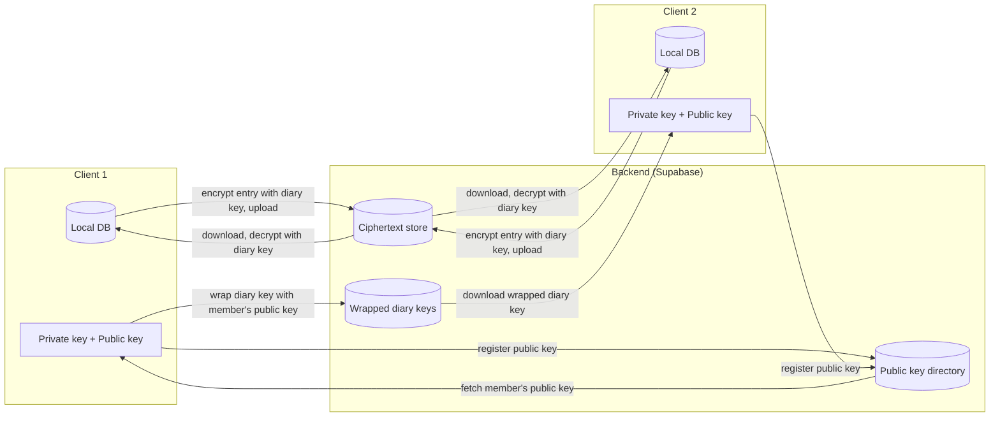

# Quill

## Overview

An zero knowledge encryption privacy-focused social journaling app. Create a diary, invite friends, and journal together.

## Screenshots

|                                       Diaries                                       |                                      Calendar                                      |                                       Entry List                                       |                                          Entry                                          |                                      Dark Mode                                       |
| :---------------------------------------------------------------------------------: | :--------------------------------------------------------------------------------: | :------------------------------------------------------------------------------------: | :-------------------------------------------------------------------------------------: | :----------------------------------------------------------------------------------: |
|  |  |  |  |  |

## Features

- **Multiple diaries**: Organize your thoughts with separate diaries which are encrypted and saved into your local database
- **Calendar**: Jump to any date and quickly add an entry with a tap
- **Rich Entries**: Bring your journals to life with beautiful text formatting, photos, videos and voice recordings
- **Accounts**: Sign up and add your own profile picture
- **Polished experience**: Haptic feedback, dark mode, and a clean design you will enjoy writing in
- **Shared Diaries**: Get invited by friends or invite them, and have a safe space to write and view each other's thoughts.
- **Different Views**: See your entries in many views: list, gallery, timeline and more.
- **More customization options**: Change the diary's color and more. We love customization and you do too.
- **Built-in applock**: Lock the app with biometrics or a custom app PIN.
- **Encrypted sync**: Your shared diaries' entries will be synced to a database using end-to-end encryption, so only you and your friends can read them.

## Upcoming Features

These features are planned but not yet implemented.

- **Notifications**: Get a notification every day to remember to keep the streak.

The diagram below shows the planned design for encrypted syncing once this feature is implemented:

## Tech Stack

- **React Native + Expo**
- **Expo Router** — used for navigation between screens
- **React Native Libsodium** - used for cryptography
- **TypeScript**
- **Local database**: SQLite via `expo-sqlite`
- **Backend**: Supabase
- **Rich text editor**: `10tap-editor` — used for implementing the editor
- **React Native Reanimated and Gesture Handler**: Used to make smooth animation and gesture-based interactions

---

Created with :heart: by NiceSapien, AmrGamalbit, and Crewshon!

